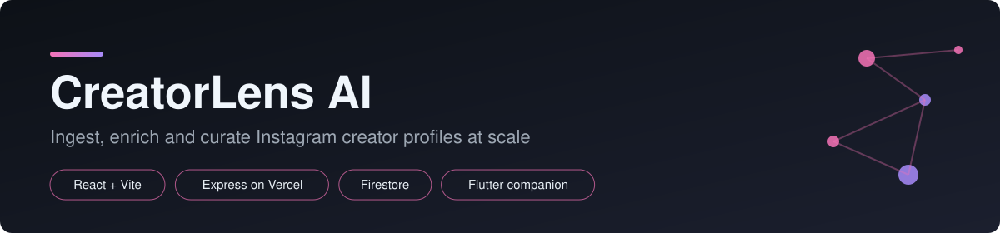
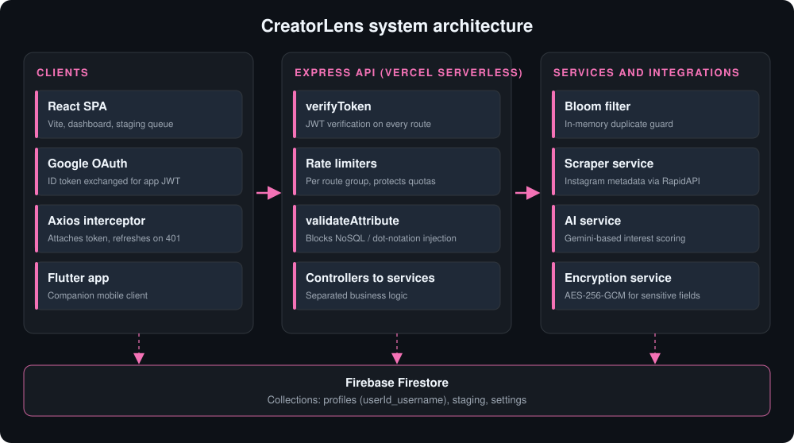

<p align="center">
  
</p>

<p align="center">
  <a href="https://createrlens.vercel.app/"><b>Live Demo</b></a>
  &nbsp;|&nbsp;
  <a href="#architecture">Architecture</a>
  &nbsp;|&nbsp;
  <a href="#api-overview">API</a>
  &nbsp;|&nbsp;
  <a href="#getting-started">Getting Started</a>
</p>

<p align="center">
  
  
  
  
  
  
</p>

# CreatorLens AI

CreatorLens AI is a workspace for discovering, enriching and curating Instagram creator profiles. Reel links go into a staging queue, an AI step pulls engagement metadata and scores each creator, and approved profiles move into a searchable, customizable table. It currently manages 2,377 profiles.

---

## Features

| Area | Details |
|---|---|
| Authentication | Google OAuth sign-in, short-lived JWT access tokens and refresh-token rotation. Axios interceptors attach tokens and refresh on expiry. |
| Per-user isolation | Every profile is stored under a composite key `userId_username`, so each account only reads and writes its own data. |
| Staging queue | New reel URLs are queued first. A separate request enriches each entry (followers, likes, comments, views) and computes an engagement score before approval. |
| Bulk operations | Mass upload of usernames, bulk approve, bulk delete, and a JSON import tool for saved-post exports. |
| Dynamic columns | Users add text or dropdown columns, hide or rename them, and reorder the table. Preferences persist per user. |
| Search and filter | Client-side search and sort, plus server-side filters, custom categories and inline notes. |
| Companion app | A Flutter mobile app for working with the same data on a phone. |
| Interface | Light and dark themes, a guided tour, an onboarding checklist and a responsive layout. |

---

## Architecture

<p align="center">
  
</p>

The frontend is a Vite single-page app. The backend is an Express application exported as a Vercel serverless function. Requests pass through `verifyToken`, are rate limited per route group, and reach controllers that call services for Firestore, scraping, AI and encryption.

### Engineering decisions

**Two-step processing for serverless limits.** Vercel functions have a 10-second execution cap, and scraping plus AI enrichment can exceed it. Work is split: one request queues the entry, and a second request (`POST /api/staging/:id/process`) enriches it. Each call stays short, so jobs finish reliably.

**Duplicate prevention.** An in-memory Bloom filter rejects repeated usernames before they reach Firestore. It is deliberately lightweight and is not preloaded on cold start. The Firestore document ID (`userId_username`) is the real uniqueness guarantee.

**Quota protection.** Rate limiters are tuned per route group, from 5 requests per minute for refresh jobs to 60 per minute for bulk imports. Bulk writes are chunked (50 items per import request) and batched, staying under Firestore batch limits.

**Input hardening.** `validateAttribute` middleware restricts dynamic column names to alphanumeric, underscore and hyphen characters, which blocks NoSQL and dot-notation injection. Sensitive fields are encrypted with AES-256-GCM.

---

## API Overview

| Method | Endpoint | Purpose |
|---|---|---|
| POST | `/api/auth/google` | Exchange a Google ID token for app tokens |
| POST | `/api/auth/refresh` | Rotate access and refresh tokens |
| POST | `/api/profiles/add` | Add one profile (checks the Bloom filter) |
| POST | `/api/profiles/mass-upload` | Bulk import usernames |
| GET | `/api/profiles/count` | Profile count for the signed-in user |
| POST | `/api/profiles/refresh-videos` | Refresh average view metrics |
| POST | `/api/staging/share` | Queue a reel URL |
| POST | `/api/staging/:id/process` | Enrich a queued entry |
| POST | `/api/staging/:id/approve` | Move an entry into profiles |
| POST | `/api/staging/bulk-approve` / `bulk-delete` | Bulk actions on staged entries |
| POST | `/api/staging/bulk-import` | Import a saved-posts JSON export |
| GET/PUT | `/api/settings/columns` | Read and update custom columns |

All routes except sign-in require a valid bearer token.

---

## Tech Stack

| Layer | Technology |
|---|---|
| Frontend | React 19, Vite, React Router, Axios, react-hot-toast |
| Mobile | Flutter |
| Backend | Node.js, Express 5, express-rate-limit, jsonwebtoken |
| Database | Firebase Firestore (firebase-admin) |
| AI and data | Google Gemini (`@google/genai`), RapidAPI Instagram scraper, bloom-filters |
| Security | JWT with refresh rotation, AES-256-GCM, input validation middleware |
| Hosting | Vercel (frontend static build and backend serverless function) |

---

## Project Structure

```
backend/
  src/
    app.js             Express composition, CORS, route mounts
    server.js          Entry point and Vercel export
    config/            Firebase admin initialization
    controllers/       auth, profile, attribute, settings, staging
    middleware/        authMiddleware, rateLimiter, validateAttribute
    routes/            Route definitions per controller
    services/          profile, settings, ai, interest, scraper,
                       encryption, bloomFilter, auth
    utils/             jwt, dateUtils, constants
  docs/architecture/   Architecture and request lifecycle notes
frontend/
  src/
    App.jsx            Router, theme provider, navigation
    components/        ProfileDashboard, StagingQueue, Tour, modals
    hooks/             useClipboard, useDragFill, useFilters
    services/api.js    Axios instance with token interceptors
    utils/             session, filters, sorter, table columns
```

---

## Getting Started

**Prerequisites:** Node.js 18+, a Firebase project with a service account, a Google OAuth client ID and a RapidAPI key for the Instagram scraper.

**1. Configure the backend.** Create `backend/.env`:

```env
JWT_SECRET=change_me
JWT_REFRESH_SECRET=change_me_too
ENCRYPTION_SECRET=exactly_32_characters_required___
FIREBASE_PROJECT_ID=your_project_id
FIREBASE_CLIENT_EMAIL=your_service_account_email
FIREBASE_PRIVATE_KEY="your_private_key"
RAPIDAPI_KEY=your_key
RAPIDAPI_HOST=your_host
GEMINI_API_KEY=your_key
CLIENT_URL=http://localhost:5173
```

**2. Install and run.**

```bash
# backend
cd backend
npm install
npm run dev        # http://localhost:5000

# frontend, in a second terminal
cd frontend
npm install
npm run dev        # http://localhost:5173
```

The Vite dev server proxies API calls to `http://localhost:5000`.

---

## Roadmap

- Add unit and integration tests for the auth middleware, Bloom filter and rate limiters.
- Persist the Bloom filter state or back it with a shared store so deduplication holds across serverless instances.
- Load allowed CORS origins from environment variables.
- Stream-parse very large JSON imports to bound memory use.

---

## Author

**Nartan Maruti Naik**
[GitHub](https://github.com/NartanNaik) | [LinkedIn](https://www.linkedin.com/in/nartan-naik-90499a359/) | naiknartana@gmail.com