# CreatorLens AI — Architecture & Dependency Failure Matrix

## 1. System Architecture Diagram

```mermaid
flowchart TD
    subgraph ClientLayer ["1. Client & Ingestion Layer"]
        IG[Instagram Mobile App] -->|Native Share Intent| FLT[Flutter Mobile Client]
        FLT -->|Normalize Shortcode & POST /ingest| V_INGEST[Vercel Serverless: Ingestion]
        R_UI[React Web Dashboard] -->|Polls Queue: GET /staging| FS_STAGING
        R_UI -->|Sequential Dispatch: step=scrape| V_SCRAPE[Vercel Serverless: Step 1 Scraper]
        R_UI -->|Sequential Dispatch: step=analyze| V_AI[Vercel Serverless: Step 2 AI]
    end

    subgraph DataLayer ["2. Persistence & Storage"]
        V_INGEST -->|Duplicate Check via Canonical Key| FS_STAGING[(Firestore: 'staging')]
        V_SCRAPE -->|Write Scraped Metrics| FS_STAGING
        V_AI -->|Write Demographics or Reject| FS_STAGING
        V_AI -.->|Migrate Approved Profiles| FS_PROD[(Firestore: 'creators' Prod)]
    end

    subgraph ExternalDependencies ["3. External Upstream Dependencies"]
        V_SCRAPE -->|HTTP GET Scrape Request| DEP_IG[Instagram CDN & HTML]
        V_AI -->|Fetch Thumbnail ArrayBuffer| DEP_CDN[Instagram Media CDN]
        
        %% AI Cascade Fleet
        V_AI -->|Primary: Gemini 1.5/2.0 Flash| DEP_GEMINI[Google Gemini API]
        V_AI -.->|Fallback 1 on 429/401| DEP_GROQ[Groq Cloud LPU Vision]
        V_AI -.->|Fallback 2 on Error| DEP_OR[OpenRouter Free Vision Fleet]
        V_AI -.->|Emergency Fallback 3| DEP_POLL[Pollinations.ai Free Endpoint]
    end

    classDef failure fill:#ffe6e6,stroke:#ff0000,stroke-width:1px;
    class DEP_IG,DEP_CDN,DEP_GEMINI,DEP_GROQ,DEP_OR,DEP_POLL failure;
```

  

## 2. External Dependency & Failure Mode Matrix

| Dependency | Purpose | Failure Mode | System Mitigation Strategy |
| :--- | :--- | :--- | :--- |
| **Instagram CDN** | HTML metadata & thumbnails | Silent DOM alterations or IP blocks (429). | Two-step async split isolates scraper crashes; failures are logged to staging with explicit manual retry UI. |
| **Google Gemini API** | Primary demographic classification | `HTTP 401` (Invalid Key) or `HTTP 429` (Quota). | Dynamic discovery fallback + Multi-provider cascade routes request to secondary providers. |
| **Groq Cloud API** | Fast LPU secondary vision fallback | Strict payload rejection (`HTTP 400`). | Payload normalizer combines system prompts into user messages; routes to OpenRouter on failure. |
| **OpenRouter Gateway** | Multi-model free vision routing | Chatty preambles violating strict JSON parsing. | **JSON Hunter Parser** uses boundary indices to guarantee parseable JSON extraction. |
| **Firebase Firestore** | Queue orchestration & storage | Spark Plan Hard Ceiling (50k reads/day). | Manual refresh UI replacing continuous polling listeners; canonical shortcodes as document keys. |
| **Vercel Serverless** | API execution runtime | 10-second execution timeout on Hobby Tier. | Split request architecture (`step=scrape` and `step=analyze`) guarantees each hop completes within 3–6 seconds. |